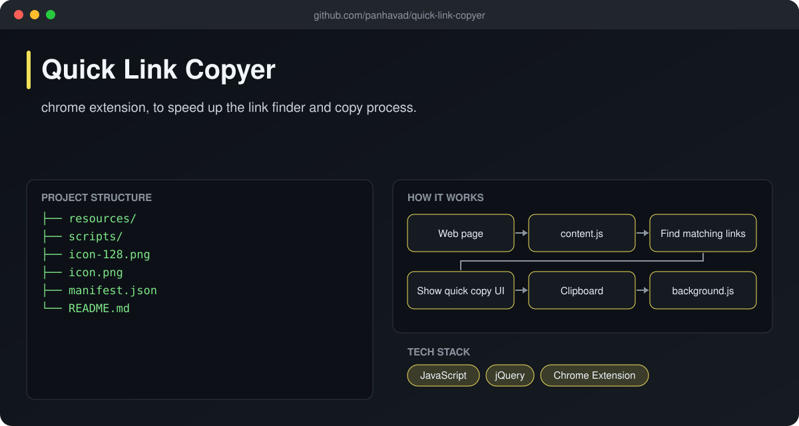
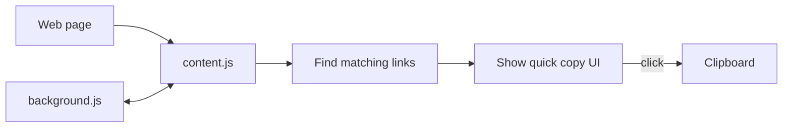

# Quick Link Copyer

  [](https://github.com/panhavad/quick-link-copyer/releases/latest)

A **Chrome extension that speeds up finding and copying links** on a page. Highlight the links you care about and copy them in one go instead of right-click -> copy over and over.



## Features

- Finds links on the current page
- One-click copy to clipboard
- Background + content script architecture
- Lightweight jQuery UI

## How it works



## Getting started

1. Download the release zip and unzip it.
2. Open `chrome://extensions`, enable **Developer mode**.
3. **Load unpacked** and select the folder.

## Download

Grab the packaged source from the [latest release](https://github.com/panhavad/quick-link-copyer/releases/latest).

## Tech stack

- JavaScript
- jQuery
- Chrome Extension

## Project structure

```text
quick-link-copyer/
├── docs/
├── resources/
├── scripts/
├── icon-128.png
├── icon.png
├── manifest.json
└── README.md
```

## Original notes

# Quick Link Copyer - Google Extension
chrome extension, to speed up the link finder and copy process.

Todos:

v1

[ ] Clean code, refine name and style

v2

[ ] Remove space when copy result

[ ] Add feature to copy all result faster
